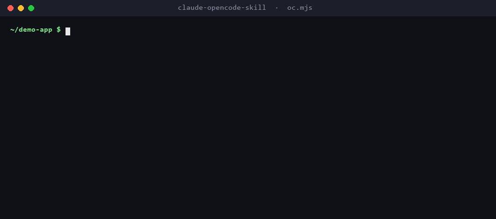

# claude-opencode-skill

[](https://github.com/kmertkun/claude-opencode-skill/actions/workflows/test.yml)

A [Claude Code](https://claude.com/claude-code) skill that hands simple chores (finding files, bulk reading, translation, small scripts) to the [OpenCode](https://opencode.ai) CLI and its **free models**, so Claude spends its tokens on the real work. Claude still checks every result.

Works on **Windows, macOS and Linux**, with OpenCode **1.x and 2.x**.



<sub>The demo replays a real run on a small sample project. The text and timings are from that run; local paths and session ids are shortened.</sub>

## Install (one command)

**macOS / Linux**

```bash
curl -fsSL https://raw.githubusercontent.com/kmertkun/claude-opencode-skill/main/install.sh | bash
```

**Windows (PowerShell)**

```powershell
irm https://raw.githubusercontent.com/kmertkun/claude-opencode-skill/main/install.ps1 | iex
```

This installs `SKILL.md` and `oc.mjs` into `~/.claude/skills/opencode` and runs `--doctor` to show which OpenCode CLI it found.

To also let Claude use the skill **on its own in every project**, add the rule to `~/.claude/CLAUDE.md`:

```bash
curl -fsSL https://raw.githubusercontent.com/kmertkun/claude-opencode-skill/main/install.sh | bash -s -- --with-rule
```

```powershell
$env:OC_WITH_RULE=1; irm https://raw.githubusercontent.com/kmertkun/claude-opencode-skill/main/install.ps1 | iex
```

Requirements: Node 18+ (Claude Code already has it) and OpenCode installed in any of these ways: desktop app, `curl -fsSL https://opencode.ai/install | bash`, Homebrew, or `npm i -g opencode-ai`.

## Usage

In Claude Code, type `/opencode <task>` or just ask for something simple. You can also call the wrapper yourself:

```bash
node ~/.claude/skills/opencode/oc.mjs --dir . "Where is the login form defined? Reply only with file:line."
node ~/.claude/skills/opencode/oc.mjs "Translate to English: ..."
node ~/.claude/skills/opencode/oc.mjs --write "Create csv_to_json.py that ..."
node ~/.claude/skills/opencode/oc.mjs --doctor
```

### Two modes

| Mode | When | What OpenCode can do |
|---|---|---|
| **read-only** (default) | `--dir <real folder>` | Only read, glob, grep and list. Writing, shell, web and MCP actions are denied by a per-run agent. Your OpenCode config is not changed. |
| **write** | `--write` | Creates files and runs commands, but **only in a fresh temp folder**. A `--dir` outside temp is refused. |

### Automatic model selection

| Task (guessed) | Chain |
|---|---|
| `search`: `--dir` given | big-pickle → deepseek-v4.1-flash-free → mimo-v2.6-flash-free |
| `text`: plain prompt | deepseek-v4.1-flash-free → big-pickle → mimo-v2.6-flash-free |
| `code`: `--write` | claude-haiku-5-5 → gpt-5.4-mini (cheap, paid) → big-pickle → deepseek-v4.1-flash-free |
| `vision`: image via `--file` | nemotron-3.5-super-vl-free → big-pickle |

Free models come first. Expensive models are never chosen automatically. With no OpenCode credits, the wrapper remembers it and skips paid models for 24 hours. Use `--free-only` to never try them.

### Finding the OpenCode CLI

`oc.mjs` looks for the CLI in this order and uses the newest working one:

- **Windows:** the OpenCode desktop app (`%LOCALAPPDATA%\Programs\*opencode*\resources\opencode-cli.exe`), `~/.opencode/bin`, and npm global installs (resolved to the real binary).
- **macOS:** `/Applications/*OpenCode*.app`, `~/.opencode/bin`, `/opt/homebrew/bin`, `/usr/local/bin`.
- **Linux:** `~/.opencode/bin`, `~/.local/bin`, `/opt/OpenCode`, `/usr/local/bin`, `/usr/bin`.
- **All platforms:** anything named `opencode` / `opencode-cli` on `PATH`.

Set `OPENCODE_BIN=/path/to/opencode` to force a specific binary.

## Türkçe

Claude Code'un basit işleri (dosya bulma, toplu okuma, çeviri, küçük betikler) OpenCode'un **ücretsiz modellerine** vermesini sağlayan bir skill. Böylece Claude, token'larını asıl işe harcar ve her sonucu yine kendisi kontrol eder. **Windows, macOS ve Linux**'ta, OpenCode **1.x ve 2.x** ile çalışır.

**Kurulum (tek komut):**
- macOS / Linux: `curl -fsSL https://raw.githubusercontent.com/kmertkun/claude-opencode-skill/main/install.sh | bash`
- Windows: `irm https://raw.githubusercontent.com/kmertkun/claude-opencode-skill/main/install.ps1 | iex`

Claude'un skill'i her projede kendiliğinden kullanması için kuralı da ekleyin: bash'te sona `-s -- --with-rule` ekleyin, PowerShell'de komuttan önce `$env:OC_WITH_RULE=1;` yazın.

**Modlar:**
- **Salt okunur (varsayılan):** Gerçek klasörlerde yalnızca okuma ve arama yapar.
- **Yazma (`--write`):** Yalnızca boş, geçici bir klasörde çalışır.

**Model seçimi:** Önce ücretsiz modeller denenir. Kod işlerinde ucuz ücretli modeller de denenir. Pahalı modeller hiçbir zaman otomatik seçilmez. Bakiye yoksa ücretli modeller 24 saat boyunca atlanır.

**Sorun giderme:** `node ~/.claude/skills/opencode/oc.mjs --doctor` komutu hangi OpenCode CLI'ın bulunduğunu gösterir.

## License

MIT
